## Featured projects

| Project | What it is |
| --- | --- |
| [EntityGen](https://github.com/lknezevicc/EntityGen) | Maven plugin that generates a Spring Boot data layer (entities, DTOs, repositories, services, REST controllers) from an existing MySQL schema. Bachelor thesis. |
| [barberbot](https://github.com/lknezevicc/barberbot) | Telegram booking bot as microservices: RabbitMQ, Redis, PostgreSQL, LLM intent classification, JWT admin API and React dashboard. |
| [brass-birmingham-lite](https://github.com/lknezevicc/brass-birmingham-lite) | Two-player JavaFX board game with RMI multiplayer, save/load, XML replay and 100+ tests. |
| [TaskFlow](https://github.com/lknezevicc/TaskFlow) | Jira-like task manager with a JavaFX client and a Spring Boot backend. |

## Stack

